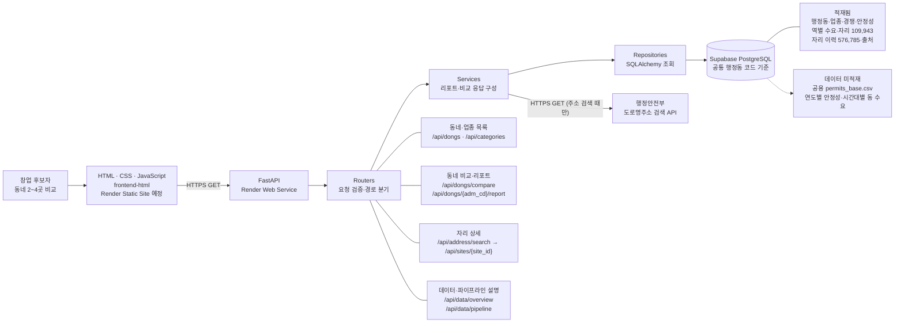
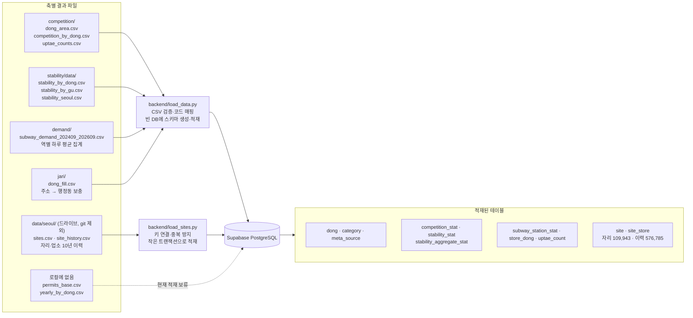

# 서비스 아키텍처

현재 구성 기준: 2026-10-18. Vanilla HTML/CSS/JavaScript 화면(`frontend-html`), Render의 FastAPI backend, Supabase 스키마와 CSV 적재가 구성되어 있습니다. Render Static Site 배포는 아직 완료되지 않았습니다. 점선 흐름은 아직 구현·배포되지 않은 연결 또는 데이터입니다.

## 서비스 요청 흐름

프론트엔드는 FastAPI만 호출합니다. Supabase 접속 문자열과 도로명주소 API 키(`JUSO_API_KEY`)는 backend 환경변수로만 관리하며 브라우저에 전달하지 않습니다.

외부 API를 요청 때마다 부르는 곳은 주소 검색(`GET /api/address/search`) 하나입니다. 입력한 주소를 도로명주소 API로 찾아 지번을 자리 키(`구 동 번지`, `jari/common.py`의 `jibun_key`와 같은 규칙)로 바꾸고 `site`와 `dong`에서 자리·행정동을 찾습니다. 나머지 API는 기준일(2026-09-30)로 미리 계산해 적재한 값만 읽습니다. 로컬 origin은 Render CORS에 허용됐습니다. 정적 사이트 배포 후에는 해당 사이트 origin도 backend의 `CORS_ORIGINS`에 추가해야 합니다.

## 데이터 수집·정규화·적재 흐름

`load_data.py --dry-run`은 CSV 형식과 행정동 코드 매핑을 검사하고, 실제 실행은 기존 애플리케이션 데이터가 없는 DB에서만 진행합니다. 수요 CSV는 역별 집계 자료이므로 `demand_stat`의 행정동×시간대 테이블에 잘못 넣지 않고 `subway_station_stat`에 적재합니다.

## 현재 제약

- `data/seoul/sites.csv`와 `data/seoul/site_history.csv`(드라이브에서 받기, git 제외)를 `backend/load_sites.py`로 적재했습니다. 자리 109,943건, 업소 이력 576,785건이며 주소 검색(`GET /api/address/search`)으로 `site_id`를 찾아 `GET /api/sites/{site_id}`에서 조회합니다.
- `store` 테이블에 들어갈 공용 `permits_base.csv`는 공유 드라이브에만 있어 로컬에 없습니다.
- `yearly_stat` 산출물과 행정동×시간대 수요 파일은 현재 없습니다. 수요는 역별 집계의 오전·저녁·밤 지표를 씁니다.
- 수집 파이프라인 API는 단계 설명만 반환합니다. 배치 실행 이력이나 실제 작업 상태를 추적하는 기능은 아직 없습니다.
- 주소 검색은 도로명주소 API가 돌려준 앞쪽 20건만 봅니다. 결과가 많으면 주소를 더 자세히 넣어야 합니다. Render에 `JUSO_API_KEY`가 없으면 주소 검색만 503을 돌려줍니다.
