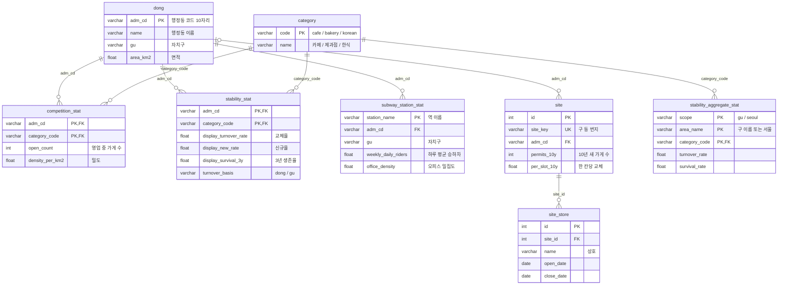

# DB 테이블 문서

Supabase(PostgreSQL)에 올린 테이블 구성입니다. 테이블 정의는 `backend/app/models/`, 적재는 `backend/load_data.py`·`backend/load_sites.py`가 합니다. 행 수는 배포된 API `GET /api/data/overview`의 `record_counts`(`meta_source`는 같은 응답의 `sources` 개수)로 확인한 값입니다(2026-10-20). `category_keyword`는 이 API가 세지 않아 확인하지 못했습니다.

## 설계 원칙

1. **모든 지표는 행정동 코드 하나로 이어집니다.** 행안부 행정동 코드 10자리(`adm_cd`)를 기본키로 하는 `dong` 표가 중심이고, 경쟁·안정성·수요·자리 표가 모두 이 코드를 외래키로 가집니다. 축마다 다른 데이터(인허가, 지하철)를 같은 동네끼리 나란히 놓을 수 있는 이유입니다.
2. **지표는 미리 계산해 넣습니다.** 기준일(2026-09-30)로 고정한 분석이라, 축별 Python 스크립트가 계산한 결과를 적재하고 API는 읽기만 합니다. 요청 때 계산하는 것은 비교용 값(경쟁 밀도의 구·서울 평균과 순위, 동별 자리 수)뿐이고, 요청 때 외부 API를 부르는 것은 주소 검색 하나입니다.
3. **업종은 표로 관리합니다.** 카페·제과점·한식을 `category` 표에 두고, 업종별 지표는 `(adm_cd, category_code)` 복합 기본키로 한 줄씩 둡니다.

## 관계도

`dong |o--o{ site`: 자리 2,082곳은 행정동을 찾지 못해 `adm_cd`가 비어 있습니다(전체 109,943곳 중).

그림에는 지표가 담긴 주요 표만 넣었습니다(`stability_aggregate_stat`은 API가 읽지 않지만 안정성 비교 기준이라 넣음). 그 밖의 외래키: `store_dong.adm_cd` → `dong`, 비어 있는 예비 표인 `store`(→ `dong`, `category`), `yearly_stat`(→ `dong`, `category`), `demand_stat`(→ `dong`). 아래 각 표 설명에 있습니다.

## 테이블 목록

| 그룹 | 테이블 | 한 줄 = | 행 수 | 원본 | 쓰는 API |
|---|---|---|---:|---|---|
| 기준표 | `dong` | 행정동 1곳 | 427 | `competition/dong_area.csv` | 동 목록, 리포트, 자리 상세, 주소 검색 |
| | `category` | 업종 1개 | 3 | `load_data.py` 안에서 정의 | 업종 목록, 리포트, 자리 상세 |
| 경쟁 | `competition_stat` | 동 × 업종 | 1,281 | `competition/competition_by_dong.csv` | 리포트, 자리 상세 |
| 안정성 | `stability_stat` | 동 × 업종 | 1,281 | `stability/data/stability_by_dong.csv` | 리포트 |
| | `stability_aggregate_stat` | 구 또는 서울 × 업종 | 78 | `stability_by_gu.csv`(75), `stability_seoul.csv`(3) | 없음 |
| 수요 | `subway_station_stat` | 지하철역 1곳 | 306 | `demand/subway_demand_202409_202609.csv` | 리포트 |
| 자리 | `site` | 지번 1곳 | 109,943 | `data/seoul/sites.csv` (드라이브) | 리포트, 자리 상세, 주소 검색 |
| | `site_store` | 그 지번에 있었던 가게 1곳 | 576,785 | `data/seoul/site_history.csv` (드라이브) | 자리 상세 |
| 메타 | `meta_source` | 데이터 출처 1개 | 3 | `load_data.py` 안에서 정의 | 없음 (출처 목록은 API 코드에 있음) |
| 보조 | `store_dong` | 가게 1곳 | 28,895 | `jari/dong_fill.csv` | 없음 (확인용) |
| | `uptae_count` | 원본 × 업태 | 64 | `competition/uptae_counts.csv` | 없음 (확인용) |
| 예비 | `store`, `yearly_stat`, `demand_stat` | | 0 | 적재 안 함 | `demand_stat`만 리포트가 조회 (항상 빈 값) |
| | `category_keyword` | | 확인 안 함 | 적재 스크립트가 채우지 않음 | 없음 |

## 테이블별 설명

### dong · 행정동 기준표

서울 427개 행정동. 다른 모든 지표 표가 이 표를 가리킵니다.

| 컬럼 | 타입 | 키 | 설명 |
|---|---|---|---|
| `adm_cd` | varchar(10) | **PK** | 행안부 행정동 코드 10자리 (예: `1111053000` 사직동) |
| `adm_cd8` | varchar(8) | UNIQUE | 앞 8자리. 생활인구 등 8자리 코드를 쓰는 데이터와 잇는 용도 |
| `stat_cd` | varchar(8) | | 통계청 행정동 코드 |
| `name` | varchar(40) | | 행정동 이름 |
| `gu` | varchar(20) | INDEX | 자치구. 구 평균을 낼 때 묶는 기준 |
| `area_km2` | float | | 면적(km²). 경쟁 밀도의 분모 |

### category · 업종

| 컬럼 | 타입 | 키 | 설명 |
|---|---|---|---|
| `code` | varchar(20) | **PK** | `cafe`, `bakery`, `korean` (API 입력값) |
| `name` | varchar(20) | UNIQUE | 카페, 제과점, 한식 |
| `sort_order` | smallint | | 화면 표시 순서 |

### competition_stat · 경쟁

"이 동네에 같은 업종 가게가 얼마나 빽빽한가". 427개 동 × 3업종 = 1,281행. 가게가 0곳인 동도 0으로 들어 있습니다.

| 컬럼 | 타입 | 키 | 설명 |
|---|---|---|---|
| `adm_cd` | varchar(10) | **PK**, FK → `dong` | |
| `category_code` | varchar(20) | **PK**, FK → `category` | |
| `open_count` | int | | 기준일에 영업 중인 가게 수 |
| `density_per_km2` | float | | `open_count ÷ dong.area_km2` |

구 평균, 서울 평균, 서울 순위는 저장하지 않고 요청 때 이 표에서 계산합니다.

### stability_stat · 안정성

"이 동네에서 이 업종이 버티나". 427개 동 × 3업종 = 1,281행.

| 컬럼 | 타입 | 키 | 설명 |
|---|---|---|---|
| `adm_cd` | varchar(10) | **PK**, FK → `dong` | |
| `category_code` | varchar(20) | **PK**, FK → `category` | |
| `open_base`, `open_now` | int | | 기준일 1년 전 / 기준일에 영업 중인 가게 수 |
| `new_1y`, `closed_1y` | int | | 최근 1년 신규 / 폐업 수 |
| `cohort_3y` | int | | 기준일 8~3년 전 개업한 가게 수 (3년 생존율의 분모) |
| `turnover_rate` | float | | 교체율 = `closed_1y ÷ open_base`. `open_base`가 20곳 미만이면 NULL |
| `new_rate` | float | | 신규율 = `new_1y ÷ open_base`. `open_base`가 20곳 미만이면 NULL. 교체율과 같이 봅니다 |
| `survival_3y` | float | | 3년 생존율 = 3~8년 전 개업한 가게 중 3년 이상 영업했거나 아직 영업 중인 비율. `cohort_3y`가 20곳 미만이면 NULL |
| `display_turnover_rate`, `display_new_rate`, `display_survival_3y` | float | | **API가 쓰는 값.** 동네 값이 NULL이면 같은 구·같은 업종 값. 구 값도 표본이 부족하면 NULL |
| `turnover_basis`, `new_rate_basis`, `survival_basis` | varchar(10) | | 표시 값의 출처: `dong`(동네 값) / `gu`(구 평균, 화면에 "구 평균 대체") / `none`(둘 다 없음). 지금 데이터에는 `none`이 없습니다 |
| `flow_type` | varchar(20) | | 비어 있음 (설명용 예비 컬럼) |

가게가 적은 동네는 비율이 크게 흔들려서 구 값으로 대체합니다. 동네 값으로 나오는 동은 교체율 기준 한식 398, 카페 286, 제과점 41곳입니다(427곳 중).

### stability_aggregate_stat · 구·서울 안정성

구 25곳 × 3업종(75행)과 서울 × 3업종(3행). 개수 컬럼(`open_base`, `open_now`, `new_1y`, `closed_1y`, `cohort_3y`)과 비율 컬럼(`turnover_rate`, `new_rate`, `survival_rate`)은 `stability_stat`과 뜻이 같습니다. `stability_stat`과 달리 `base_date`(기준일)와 `survived_3y`(3년 생존 수)가 있고, `display_*`·`*_basis`·`flow_type`은 없습니다.

| 컬럼 | 타입 | 키 | 설명 |
|---|---|---|---|
| `scope` | varchar(10) | **PK** | `gu` 또는 `seoul` |
| `area_name` | varchar(20) | **PK** | 구 이름, 또는 서울 |
| `category_code` | varchar(20) | **PK**, FK → `category` | |

구 이름은 `dong.gu`와 같은 글자지만 `dong` 표에 구 단위 행이 없어서 외래키는 걸지 않았습니다.

### subway_station_stat · 수요 (지하철역)

서울 지하철역 306곳, 역이 있는 행정동은 225곳입니다. 2024-09~2026-09 승하차를 하루 평균으로 낸 값입니다. 승하차는 타고 내린 인원을 더한 값이라 유동인구와 다릅니다.

| 컬럼 | 타입 | 키 | 설명 |
|---|---|---|---|
| `station_name` | varchar(100) | **PK** | 역 이름. 환승역은 한 역으로 합침 |
| `adm_cd` | varchar(10) | FK → `dong`, INDEX | 역 좌표가 있는 행정동 |
| `gu` | varchar(20) | | 자치구 |
| `weekday_daily_riders`, `weekend_daily_riders` | float | | 평일 / 주말 하루 평균 승하차 |
| `weekly_daily_riders` | float | INDEX | (평일 × 5 + 주말 × 2) ÷ 7. 정렬 기준 |
| `weekend_weekday_ratio` | float | | 주말 ÷ 평일. 1보다 크면 주말에 더 붐빔 |
| `morning_alighting`, `morning_boarding` | float | | 07~09시 하차 / 승차 |
| `office_density` | float | | 아침 하차 ÷ 아침 승차. 1보다 크면 업무지구 |
| `evening_alighting`, `night_boarding` | float | | 18~20시 하차 / 22~23시 승차 |

한 동네에 역이 여러 개면 여러 행이고, 역이 없는 동네는 행이 없습니다.

### site · 자리

같은 지번(층·호 구분 없음) 한 곳. 최근 10년(2016-09-30 ~ 2026-09-30) 동안 일반음식점·휴게음식점·제과점이 영업한 지번 109,943곳입니다. 10년 전부터 같은 가게가 계속 있어서 새로 들어온 가게가 0인 자리도 40,480곳 포함됩니다.

| 컬럼 | 타입 | 키 | 설명 |
|---|---|---|---|
| `id` | int | **PK** | URL용 번호 (`/api/sites/{id}`) |
| `site_key` | varchar(100) | UNIQUE | `구 동 번지` (예: `중구 황학동 479`). 주소 검색이 이 값으로 찾음 |
| `gu` | varchar(20) | INDEX | 자치구 |
| `adm_cd` | varchar(10) | FK → `dong`, INDEX, NULL 가능 | 행정동. 2,082곳은 NULL |
| `permits_10y` | int | | 최근 10년 새로 들어온 가게 수 |
| `max_concurrent` | int | | 최근 10년 동시에 영업한 최대 가게 수. 1이면 가게 한 곳짜리 자리 |
| `per_slot_10y` | float | | `permits_10y ÷ max_concurrent` (한 칸당 교체 횟수) |
| `closed_10y`, `avg_months_closed` | int, float | | 최근 10년 폐업 수, 폐업한 가게의 평균 영업 개월 |
| `open_now`, `open_now_names` | int, text | | 기준일에 영업 중인 가게 수와 상호 |
| `dong_avg_single` | float | | 같은 동 단독 자리(`max_concurrent = 1`)들의 평균 `permits_10y` |
| `dong_avg_per_slot` | float | | 같은 동 전체 자리의 평균 `per_slot_10y` |

`id`(대리키)와 `site_key`(자연키, UNIQUE)를 따로 둔 이유: 주소 문자열은 길고 공백·한글이 있어 URL과 외래키로 쓰기 불편하기 때문입니다.

### site_store · 자리의 가게 이력

`site` 한 곳에 있었던 가게들. 576,785행 (일반음식점 441,797 / 휴게음식점 121,583 / 제과점 13,405).

| 컬럼 | 타입 | 키 | 설명 |
|---|---|---|---|
| `id` | int | **PK** | |
| `site_id` | int | FK → `site` (삭제 시 같이 삭제), INDEX | |
| `mgt_nos` | text | UNIQUE(`site_id`, `mgt_nos`) | 인허가 관리번호. 주인만 바뀐 가게는 합쳐서 여러 개 |
| `name` | varchar(200) | | 상호 |
| `kind` | varchar(20) | | 원본: `restaurant` / `cafe` / `bakery` |
| `uptae` | varchar(50) | | 업태 (한식, 커피숍 등) |
| `open_date`, `close_date` | date | | 개업일, 폐업일 (영업 중이면 NULL) |
| `months` | float | | 영업 개월. 영업 중이면 기준일까지 |
| `merged` | int | | 같은 가게로 합친 인허가 수 (15,234행이 1 이상) |

### meta_source · 데이터 출처

| 컬럼 | 타입 | 키 | 설명 |
|---|---|---|---|
| `key` | varchar(40) | **PK** | |
| `name`, `provider`, `url` | varchar | | 데이터 이름, 제공 기관, 주소 |
| `axis` | varchar(40) | | 쓰는 축 |
| `fetched_at` | date | | 내려받은 날 (지금은 비어 있음) |

3개(인허가, 지하철 일별 승하차, 행정동 경계)만 들어 있습니다. API(`GET /api/data/overview`)는 이 표 대신 `backend/app/services/data_service.py`에 둔 출처 9개를 줍니다(데이터 분석 페이지와 같은 목록).

### store_dong, uptae_count · 확인용 보조 표

- `store_dong` (PK `source` + `mgt_no`, FK `adm_cd` → `dong`): 좌표가 없어 행정동을 못 붙인 가게 28,895곳을 도로명주소 API로 채운 결과. 지번으로 27,650곳, 도로명으로 1,245곳.
- `uptae_count` (PK `id`): 인허가 원본 파일별 업태 분포 64줄. 업종을 나눈 근거를 확인하는 용도.

### 예비 테이블 (비어 있음)

| 테이블 | 키 | 들어갈 내용 | 비어 있는 이유 |
|---|---|---|---|
| `store` | PK `source` + `mgt_no`, FK `adm_cd` → `dong`, `category_code` → `category` | 가게 한 곳씩의 인허가 기록 | 공용 파일 `permits_base.csv`를 적재하지 않음. 화면은 미리 계산한 지표만 씀 |
| `yearly_stat` | PK `adm_cd` + `category_code` + `year` | 연도별 신규·폐업 수 | 원본 결과 파일이 없음 |
| `demand_stat` | PK `adm_cd` + `hour` | 행정동 × 시간대 수요 | 수요는 역 단위로만 계산함 (`subway_station_stat`) |
| `category_keyword` | PK `keyword` | 업종 분류 키워드 | 쓰지 않음 |

## 화면 요청 하나가 읽는 표

`GET /api/dongs/compare?adm_cds=1111053000&adm_cds=1114055000&category=cafe` (사직동 · 명동 카페 비교) 한 번에, 동네마다:

1. `dong`에서 동 정보
2. `category`에서 업종 확인
3. `competition_stat`에서 가게 수·밀도, 같은 표로 구·서울 평균과 순위 계산
4. `stability_stat`에서 표시용 비율과 출처(`dong`/`gu`)
5. `site`에서 그 동의 자리 수와 동 평균
6. `demand_stat`(비어 있음)과 `subway_station_stat`에서 그 동의 수요

주소 검색(`GET /api/address/search`)은 도로명주소 API가 돌려준 지번으로 `site.site_key`를 찾고, 행정동 이름은 `dong`에서 찾습니다. 자리 상세(`GET /api/sites/{id}`)는 `site`와 `site_store`를 읽고, 그 동의 선택 업종 밀도를 비교하려고 `dong`과 `competition_stat`을 읽습니다(위 1~3).
